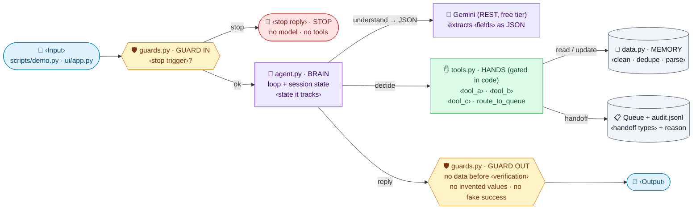
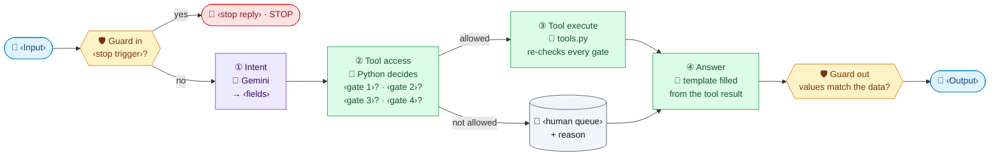

<!-- TEMPLATE for /discovery §5 + §5b. Works for ANY use case and shape (chat, batch, Q&A).
Copy it EXACTLY: same headings, node IDs, shapes, arrow labels, classDef names/colors, the ⇧⌘V line and the 4-row table.
Replace every ‹slot› with this project's words (keep each label short: 2–3 lines max). Delete nothing, add no boxes.
See templates/example_refill.md for a filled-in version.

SLOT GUIDE (examples, pick what fits):
‹Input›            SMS message · chat message · email · invoice row · support ticket · question
‹stop trigger›     emergency words · legal threat / chargeback · fraud signal · self-harm · prompt injection · off-topic
‹stop reply›       'Call 911' · 'A specialist will contact you' · 'I can only help with X'
‹fields›           intent + IDs + amounts + dates the rules need
‹verification›     identity check (name+DOB, order#+email) · account match · 'none: public data'
‹gate n›           verified? · owns the record? · within window? · under limit? · not final-sale? · confirmed?
‹human queue›      staff queue · manager approval · finance review · on-call engineer
‹Output›           reply to user · row in results.csv · drafted email awaiting approval -->

<!-- SAFE MERMAID ONLY (tested in the VS Code ⇧⌘V preview): quoted labels,  , emojis, shapes [""] ([""]) {{""}} [("")],
solid arrows with optional "labels", classDef/class. NEVER: <i>/<b> or other HTML tags, dotted arrows (-. .->),
two-way arrows (<-->), chained arrows (A --> B --> C), subgraphs, and `flowchart TD`.
Always `flowchart LR`: the preview's pan/zoom fit pushes tall TD diagrams out of view. -->

## 5. Architecture
> Open the preview to see the diagram: **⇧⌘V** (or the preview icon at the top right of this tab).

In short, the model only **extracts** (‹fields›). Python makes every decision and writes every reply from templates filled with tool results.

### 5b. Agent loop: who decides what
The same 4 stages as a typical agent, but the LLM owns **only step ①**. Purple = LLM · green = Python.

| Stage | Typical agent | This agent | Why |
|---|---|---|---|
| ① Intent | LLM | **LLM** (Gemini returns JSON) | Messy text is what LLMs are good at |
| ② Tool access | LLM picks the tool | **Python decides** | A prompt can be talked into "‹the most dangerous request›"; an `if` can't |
| ③ Tool execute | Tool runs | **Tool runs and re-checks every gate** | Defense in depth: a bug in ② still can't ‹do the risky action› |
| ④ Answer | LLM writes it | **Python template** (or LLM draft + fact check + human approval) | It can't invent ‹values that must come from the data› |
