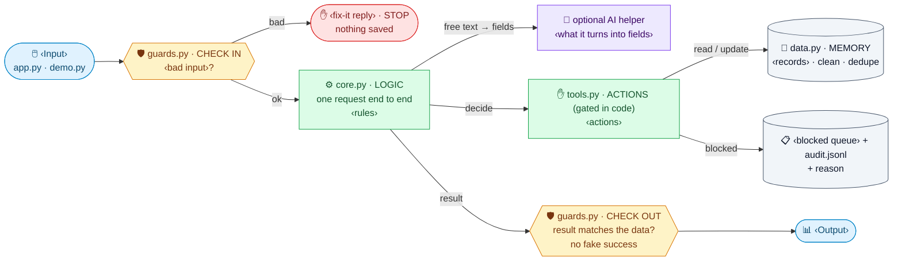
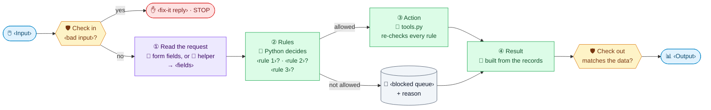

<!-- TEMPLATE for /discovery §5 + §5b when the kind is APP (no AI, or AI as one optional helper).
Copy it EXACTLY: same headings, node IDs, shapes, arrow labels, classDef names/colors, the ⇧⌘V line and the 4-row table.
Replace every ‹slot› with this project's words (keep each label short: 2–3 lines max). Delete nothing, add no boxes.
If the plan has one AI helper (e.g. "parse a free-text request into a booking"), keep node H and fill it in;
if there is no AI at all, set H's label to "🧩 no AI helper all input is structured" (keep the node: same diagram every time).

SLOT GUIDE (examples, pick what fits):
‹Input›            booking form · filter + date range · uploaded CSV · new ticket · button click
‹bad input›        missing field · wrong format · date in the past · unknown ID · file too big
‹fix-it reply›     'Pick a date from tomorrow on' · 'Column "amount" is missing' · 'That ID does not exist'
‹rules›            slot free? · within opening hours? · under capacity? · user allowed? · state change allowed?
‹actions›          book_slot · cancel · approve · move_state · export_csv
‹records›          bookings · tickets · approvals · results
‹blocked queue›    needs-approval list · conflicts list · errors to fix
‹Output›           confirmation + updated calendar · filtered chart + table · ticket in its new state -->

<!-- SAFE MERMAID ONLY (tested in the VS Code ⇧⌘V preview): quoted labels,  , emojis, shapes [""] ([""]) {{""}} [("")],
solid arrows with optional "labels", classDef/class. NEVER: <i>/<b> or other HTML tags, dotted arrows (-. .->),
two-way arrows (<-->), chained arrows (A --> B --> C), subgraphs, and `flowchart TD`.
Always `flowchart LR`: the preview's pan/zoom fit pushes tall TD diagrams out of view. -->

## 5. Architecture
> Open the preview to see the diagram: **⇧⌘V** (or the preview icon at the top right of this tab).

In short, every rule is plain Python in `core.py` + `tools.py`; the screen only shows what the records say.

### 5b. One request: who decides what
Purple = AI (optional helper only) · green = Python.

| Stage | Typical quick app | This app | Why |
|---|---|---|---|
| ① Read | Trust the form | **Check in first** (‹bad input›) | Bad input is caught before anything is saved |
| ② Rules | Scattered in the UI code | **One place: core.py** | Easy to test, easy to show on stage |
| ③ Action | Writes straight away | **Re-checks every rule** | A UI bug still can't ‹do the risky action› |
| ④ Result | Whatever the code returns | **Built from the saved records** | The screen can't show something that didn't happen |
