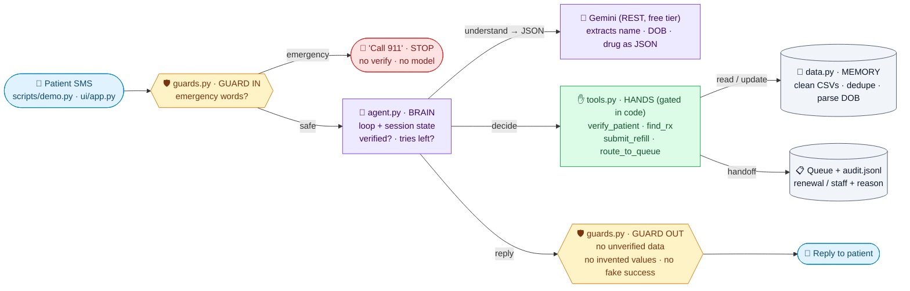
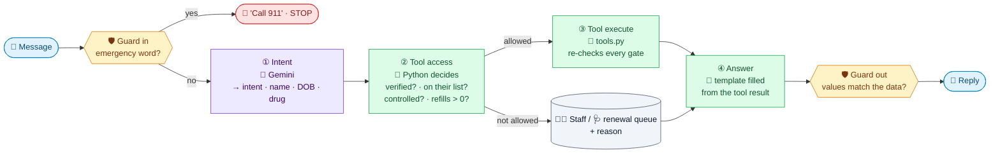

<!-- WORKED EXAMPLE (refill-request agent). Shows how templates/architecture.md looks when filled in. Do not copy its labels. -->

## 5. Architecture
> Open the preview to see the diagram: **⇧⌘V** (or the preview icon at the top right of this tab).

In short, the model only **extracts** (intent, name, DOB, drug). Python makes every decision and writes every reply from templates filled with tool results.

### 5b. Agent loop: who decides what
The same 4 stages as a typical agent, but the LLM owns **only step ①**. Purple = LLM · green = Python.

| Stage | Typical agent | This agent | Why |
|---|---|---|---|
| ① Intent | LLM | **LLM** (Gemini returns JSON) | Messy text is what LLMs are good at |
| ② Tool access | LLM picks the tool | **Python decides** | A prompt can be talked into "refill my oxycodone"; an `if` can't |
| ③ Tool execute | Tool runs | **Tool runs and re-checks every gate** | Defense in depth: a bug in ② still can't refill |
| ④ Answer | LLM writes it | **Python template** | It can't invent a drug, pharmacy or pickup time |
