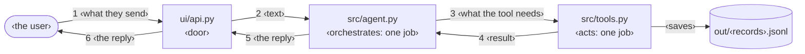

<!-- TEMPLATE for docs/plan.md: the TECHNICAL file, the implementation spec. The LLM that runs /build writes the code
from it, so every function is specified completely (what it does, in order; what goes in; what comes out). The user
approves it before any code. The plain-English WHAT and WHY live in docs/spec.md: cite its ids (S1, B1, D1, G1, E1),
never restate them. The kit's parsers read: the Status line, "Files", the "How it works" diagram, the `#### ` function
blocks in "Functions" and "Evals", the phase lines, Try it and Requirements. -->
# Plan: ‹product name›

**Status:** draft

## 1. Overview
‹Kind + shape and why, in one line. LLM: "Gemini free tier via .env, extracts ‹fields› only" or "No AI: every step
is plain Python." One line on the path a request takes. What it must do and why: docs/spec.md.›

‹API shape only: **Scale:** the data today and the size the notes name · what the POC does per request · what breaks
first · the change that fixes it and the number it aims at.›

## 2. Files
**Every file the build writes**, by phase (CLAUDE.md "Coding standards": fewest files, each with one job).
`spec.py check` fails on a code file that isn't here, and on a ticked phase whose files don't exist.
| File | Phase | Job | Takes in | Gives back |
|---|---|---|---|---|
| `src/agent.py` | 1 | ‹orchestrate: one chat› | ‹a message› | ‹the reply› |
| `ui/api.py` | 1 | ‹door: the screen as JSON + the chat› | ‹HTTP {"session", "text"}› | ‹{"reply"}; the screen JSON› |
| `ui/web/` | 1 | kit React template, copied as is | `/api/screen` JSON | the page |
| `evals/scenarios.py` | 1 | ‹spec S1–S3 + bonus as data with checks› | ‹an Agent factory› | ‹board rows› |
| `tests/test_phase1.py` | 1 | ‹proves P1.R*› | — | — |

**How it's checked** (three layers, each with one job; §6 explains the evals):
- **Tests** (`tests/`): one test per requirement in §7, run while building.
- **Scenario board** (`evals/scenarios.py`): spec S1–S3 and the bonus played end to end, with their checks.
- **Evals** (`evals/run.py`): every case in spec.md §7, one score.

## 3. How it works
One simple diagram: **one box per product file in §2** (`src/…`, `ui/api.py`) labeled with its job, the data stores it
reads or writes, and the user at each end. Each arrow says what it carries, and the arrows one request follows are
numbered 1, 2, 3, … in order; background arrows (loading, saving, the owner's view) stay unnumbered. A guard, a queue or a stop box appears only
when a spec.md rule needs one. `spec.py check` fails when a product file has no box. SAFE MERMAID (CLAUDE.md).



| Step | Who decides | Why |
|---|---|---|
| ‹read the messy input› | ‹LLM / Python› | ‹…› |
| ‹every rule in spec.md› | Python | ‹a prompt can be argued with; an `if` can't› |

## 4. Functions
The implementation spec: every function the rest of the code calls, grouped by file in `src/` (split by kind of work:
the model call, the orchestration, the decisions, the reads and writes). **At first glance** each function is one
heading, one plain sentence, and its In and Out; how it does it sits in a dropdown (`<details>`, click to open in
VS Code or GitHub):
- one `### \`<file>\` — <its one job>` per file, then per function `#### \`<name>\` — <short title or question>` and
  one visible sentence: its docstring line 1, word for word; then **In** and **Out**, visible. How it does it (the full
  signature on its own line, **Why** and **Does**) sits in a dropdown;
- **Does**: what it does, in order, as numbered steps in plain words; every path, with what it returns and its rule.
  This is what the code is built from: no Python here;
- **In** · the arguments, by name (```jsonc): each `// <type from the signature> · <what it is>`, the fields it uses
  commented with why they matter; fields it doesn't use become `"…"`, but **identifier fields always stay** (`id`,
  names) so you can tell which record it is;
- **Out** · `<return type>` (```jsonc or ```text): one real example, important fields commented.

Values are real and pretty-printed (2-space indent, comments after two spaces), shown by what they hold (never code),
with placeholders in prose in backticks. `ui/api.py` and tests are not explained here: their §2 line is enough.

### `src/tools.py` — ‹acts: one job›

#### `‹tool›` — ‹what it does, as a short title or question›
‹docstring line 1: one plain sentence, what it takes and gives back›.

**In** · the arguments, by name
```jsonc
{
  "‹param›": {  // dict · ‹what it is›
    "id": "‹real id›",  // which record this is
    "‹field›": "‹real value›",  // ‹why this field matters here (rule)›
    "…": "‹what was left out›"
  }
}
```

**Out** · `dict | None`
```jsonc
{
  "id": "‹real id›",
  "‹field›": "‹real value›"  // ‹what it means›
}
```

<details><summary>How it does it: signature, why, steps</summary>

`‹tool›(‹param›: dict) -> dict | None`

**Why** ‹why it works this way, citing its rule›.

**Does**
1. ‹If …, returns `null` (B1).›
2. ‹Otherwise …, saves … and returns the saved row (B3).›

</details>

## 5. Records
Each record as typed JSON (where it lives, every field and its type). JSON is how a Python dictionary looks written
down (`null` = `None`, `true` = `True`). `.jsonl` ("JSON Lines") is a text file with one JSON object per line; lines are
only ever added, never changed.
### ‹record› (`out/‹name›.jsonl`)
```json
{
  "‹field›": "str",
  "‹field›": "int",
  "at": "str (ISO time)"
}
```

## 6. Evals
How we know it works, explained so a newcomer can follow: what a scenario and an eval case are (shown as data), how one
runs, and what the score means. The functions use the same format as §4.

### `evals/scenarios.py` · the Scenario board: spec S1–S3 and the bonus, played end to end
A **scenario** is one demo story from spec.md §2 written as data. ‹Show one, real values:›
```jsonc
{
  "id": "S1",  // the spec.md §2 scenario
  "commands": [  // typed in order into a fresh ‹Agent / Desk›
    "‹S1 input›"
  ],
  "lines": [  // what the user must see, in order
    "‹the exact reply›"
  ],
  "checks": [  // must be true at the end
    "‹a record was written›"
  ]
}
```
How one runs: a fresh ‹Agent / Desk› on an empty records folder → each command in order → a 🚧 line means `not_built`
(checks not looked at) → otherwise every check: all true `pass` ✅, any false `fail` ❌.
‹Then `#### \`run_all(…) -> list[Result]\` · \`evals/scenarios.py\`` with Does, In and Out.›

### `evals/run.py` · the evals: every case in spec.md §7, one score
An **eval case** is one row of spec.md §7: its input and the one line that must come back. ‹Show one, real values.›
‹One sentence on board vs evals for this project: AI → the evals call the real model, the board stays offline.›
‹Then `#### \`main() -> dict\` · \`evals/run.py\``: Does, In, and Out = passed · total · one entry per case.›

## 7. Phases
Every `On screen` and `Try it` line describes the app **after** that phase is built and ticked. Expected replies are in
"quotes". A Try-it line never quotes text that only appears after a click. Requirements cite spec.md (`B<n>`, `D<n>`),
`raw.md:L<n>`, `data/<file>` or `user <date>: "<words>"`; each names the test that proves it.
- [ ] Phase 1: the app shell (everything visible, nothing working yet)
  - **On screen (before → after):** ‹nothing → both tabs, every panel ⬜, board all ⬜, chat 🚧›
  - **Builds:** the phase-1 rows of §2 Files
  - **Try it:**
    1. `‹S1 input›` → "‹🚧 … arrives in phase 2.›"
    2. Open the 📊 Owner dashboard tab → every panel shows "‹⬜ KPIs: arrives in phase 2›"
  - **Requirements:**
    - **P1.R1** · ‹title›
      - Traces to: ‹spec.md §3 · raw.md:L‹n››
      - Acceptance: `‹input›` → "‹exact text›"
      - Test: tests/test_phase1.py::test_r1_‹name›
- [ ] Phase 2: scenario 1 works end to end
  - … (same four parts)
- [ ] Phase 3: safety + scenarios 2–3
  - …
- [ ] Phase 4: evals + talk
  - …

## 8. Likely questions (filled in the last phase, from what was built)
The technical questions a client or interviewer will most likely ask, each answered in 1–2 lines, naming the function
that does it (never file:line). Cover: why an LLM at all · prompt injection · a case the guard word list misses · is the
board mocked (offline board vs live evals) · concurrency / scale · what it never does · cost and model · next fix.
- **‹question›** ‹answer› (`‹function()›`)
