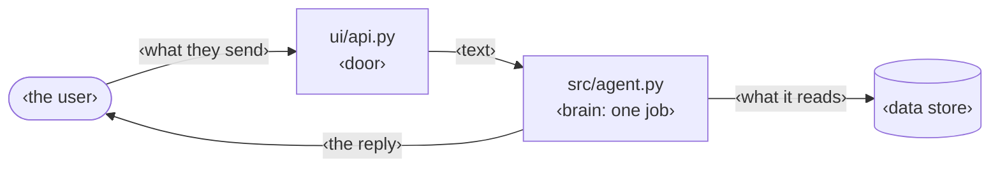
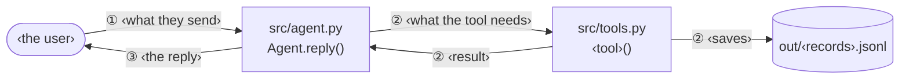

<!-- TEMPLATE for docs/plan.md: the TECHNICAL file. HOW it's built: every file, every function with what goes in and
what comes out, the records, scenario 1 step by step, and the phases. The user approves it before any code.
The plain-English WHAT and WHY live in docs/spec.md: cite its ids (S1, B1, D1, G1, E1), never restate them.
The kit's parsers read: the Status line, "Files", "Functions", "Flow", the phase lines, Try it and Requirements. -->
# Plan: ‹product name›

**Status:** draft

## 1. Overview
‹Kind + shape and why, in one line. LLM: "Gemini free tier via .env, extracts ‹fields› only" or "No AI: every step
is plain Python." One line on the path a message takes. What it must do and why: docs/spec.md.›

## 2. Architecture
Drawn from this plan, not from a template: **one box per product file in §3 Files** (`src/…`, `ui/api.py`), the data
stores it reads or writes, the user at each end, and one arrow per call, labeled with the data it carries (from §4).
A guard, a queue or a stop box appears only when a spec.md rule needs one. `spec.py check` fails when a product file
has no box, or a box names a file §3 doesn't list. SAFE MERMAID (CLAUDE.md): `flowchart LR`, quoted labels, solid
labeled arrows, no dead ends.



### Who decides what
| Step | Who | Why |
|---|---|---|
| ‹read the messy input› | ‹LLM / Python› | ‹…› |
| ‹every rule in spec.md› | Python | ‹a prompt can be argued with; an `if` can't› |

## 3. Files
**Every file the build writes**, by phase (CLAUDE.md "Coding standards": fewest files, each with one job).
`spec.py check` fails on a code file that isn't here, and on a ticked phase whose files don't exist.
| File | Phase | Job | Takes in | Gives back |
|---|---|---|---|---|
| `src/agent.py` | 1 | ‹brain: one chat› | ‹a message (str)› | ‹the reply (str)› |
| `ui/api.py` | 1 | ‹door: the screen as JSON + the chat› | ‹HTTP {"session", "text"}› | ‹{"reply"}; the screen JSON› |
| `ui/web/` | 1 | kit React template, copied as is | `/api/screen` JSON | the page |
| `evals/scenarios.py` | 1 | ‹spec S1–S3 + bonus as data with checks› | ‹an extractor, an Agent factory› | ‹board rows› |
| `tests/test_phase1.py` | 1 | ‹proves P1.R*› | — | — |

## 4. Functions
Every function the rest of the code calls, file by file: one `###` per Python file (tests excepted), one `####` per
function. Under it: its docstring line 1 word for word, then `*Why:*`; then **In**, the real arguments as one JSON object
(`{"<param>": <real value>, …}`), and **Out**, the real value it returns. Both are pretty-printed ```json blocks
(```text for plain text). Anything the call doesn't read is replaced by `"…": "<what was left out>"`, so you see exactly
what goes in. §5 names the record shapes.

### `src/agent.py` · brain: ‹one job›

#### `Agent.reply(text: str) -> str`
‹One message in, one checked reply out›. *Why:* ‹why›.

**In**
```json
{
  "text": "‹S1 input›"
}
```

**Out**
```text
‹the exact reply›
```

### `src/tools.py` · hands: ‹one job›

#### `‹name›(‹params›) -> ‹type›`
‹docstring line 1›. *Why:* ‹why›.

**In**
```json
{
  "‹param›": "‹the real value, with only the fields this call reads›",
  "…": "‹what was left out, e.g. 4 more requests›"
}
```

**Out**
```json
‹the real JSON it returns›
```
‹Optional: the other outcome, e.g. "wrong name → `null`".›

## 5. Records
Each record as typed JSON (where it lives, every field and its type).
### ‹record› (`out/‹name›.jsonl`)
```json
{"‹field›": "str", "‹field›": "int", "at": "str (ISO time)"}
```

## 6. Flow (S1): one request, start to finish
Spec S1 told hop by hop. The diagram's arrows are numbered ①, ②, … in the order things happen, and each number is the
step below with that number: read the diagram, then the step. Each step shows the call, the file, why, and what goes
**In** and comes **Out** as real JSON ("…" marks parts the step doesn't read). `tests/test_flow.py` makes each call
with its In and checks the result against its Out, so this story can't drift from the code.



### 1 · ‹what happens, in plain words›
`‹tool(…)›` in `‹src/tools.py›`. ‹One line on why this step exists.›

**In**
```json
{
  "‹param›": "‹real value›"
}
```

**Out**
```json
‹the real result›
```

### 2 · ‹…›
…

### 3 · The reply the user sees
`‹Agent.reply("<S1 input>")›` in `src/agent.py`.

**In**
```json
{
  "text": "‹S1 input›"
}
```

**Out**
```text
‹the exact reply›
```

## 7. Phases
Every `On screen` and `Try it` line describes the app **after** that phase is built and ticked. Expected replies are in
"quotes". A Try-it line never quotes text that only appears after a click. Requirements cite spec.md (B<n>, D<n>),
raw.md:L<n>, data/<file> or `user <date>: "<words>"`; each names the test that proves it.
- [ ] Phase 1: the app shell (everything visible, nothing working yet)
  - **On screen (before → after):** ‹nothing → both tabs, every panel ⬜, board all ⬜, chat 🚧›
  - **Builds:** the phase-1 rows of §3 Files
  - **Try it:**
    1. `‹S1 input›` → "‹🚧 … arrives in phase 2.›"
    2. Open the 📊 Owner dashboard tab → every panel shows "‹⬜ KPIs: arrives in phase 2›"
  - **Requirements:**
    - **P1.R1** · ‹title›
      - Traces to: ‹spec.md §3 · raw.md:L‹n››
      - Acceptance: `‹input›` → "‹exact text›"
      - Test: tests/test_phase1.py::test_r1_‹name›
- [ ] Phase 2: scenario 1 works end to end
  - … (same four parts)
- [ ] Phase 3: safety + scenarios 2–3
  - …
- [ ] Phase 4: evals + talk
  - …

## 8. Likely questions (filled in phase 4, from what was built)
The technical questions a client or interviewer will most likely ask, each answered in 1–2 lines, naming the function
that does it (never file:line). Cover: why an LLM at all · prompt injection · a case the guard word list misses · is the
board mocked (offline board vs live evals) · concurrency / scale · what it never does · cost and model · next fix.
- **‹question›** ‹answer› (`‹function()›`)
