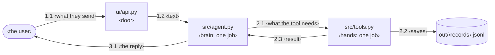

<!-- TEMPLATE for docs/plan.md: the TECHNICAL file. HOW it's built, told as ONE flow: the files, then scenario 1 step
by step, where each step is the place its function is explained (what goes in, what comes out), then the evals.
The user approves it before any code. The plain-English WHAT and WHY live in docs/spec.md: cite its ids (S1, B1, D1,
G1, E1), never restate them. The kit's parsers read: the Status line, "Files", "How it works" (its diagram, its
`### Step <n>` headings and its `#### ` function blocks), "Evals", the phase lines, Try it and Requirements. -->
# Plan: ‹product name›

**Status:** draft

**How to read this (5 minutes):** §1 Overview, then §3's code-at-a-glance table and diagram give a good rough
idea of the whole system. Go to a §3 Step only when you want the detail of one function.

## 1. Overview
‹Kind + shape and why, in one line. LLM: "Gemini free tier via .env, extracts ‹fields› only" or "No AI: every step
is plain Python." One line on the path a request takes. What it must do and why: docs/spec.md.›

## 2. Files
**Every file the build writes**, by phase (CLAUDE.md "Coding standards": fewest files, each with one job).
`spec.py check` fails on a code file that isn't here, and on a ticked phase whose files don't exist.
| File | Phase | Job | Takes in | Gives back |
|---|---|---|---|---|
| `src/agent.py` | 1 | ‹brain: one chat› | ‹a message› | ‹the reply› |
| `ui/api.py` | 1 | ‹door: the screen as JSON + the chat› | ‹HTTP {"session", "text"}› | ‹{"reply"}; the screen JSON› |
| `ui/web/` | 1 | kit React template, copied as is | `/api/screen` JSON | the page |
| `evals/scenarios.py` | 1 | ‹spec S1–S3 + bonus as data with checks› | ‹an Agent factory› | ‹board rows› |
| `tests/test_phase1.py` | 1 | ‹proves P1.R*› | — | — |

**How it's checked** (three layers, each with one job; §5 explains the evals):
- **Tests** (`tests/`): one test per requirement in §6, run while building.
- **Scenario board** (`evals/scenarios.py`): spec S1–S3 and the bonus played end to end, with their checks.
- **Evals** (`evals/run.py`): every case in spec.md §7, one score.

## 3. How it works: spec S1, one request from start to finish
One diagram and one story. The diagram has **one box per product file in §2** (`src/…`, `ui/api.py`), the data each
reads or writes, and the user at each end; a guard, a queue or a stop box appears only when a spec.md rule needs one.
Each arrow carries the data it passes and a number `step.sub-step` (1.1, 1.2, then 2.1, …): the first number is the
step below. `spec.py check` fails when a product file has no box, or the numbers and the steps don't match.

**The code at a glance**: every function, one row each, in the order S1 uses them (then the others), each linked to
its block below. `spec.py check` makes sure each explained function has exactly one row, with the same file.
| Step | Function | File | What it does | Example: In → Out |
|---|---|---|---|---|
| 1 | `‹tool›` | `src/tools.py` | ‹docstring line 1, short› | `‹("T-100", "Nguyen")›` → `‹{"bike": "blue Trek", …}›` |
| 2 | `Agent.reply` | `src/agent.py` | ‹one message in, one checked reply out› | `‹"is my bike ready? T-100 Nguyen"›` → `‹"Your blue Trek is ready. …"›` |
| — | `‹other›` | `src/‹file›.py` | ‹…› | `‹…›` → `‹…›` |
The example column is one line of real values (a cell can't hold more); the full, commented JSON is in each Step.



| Step | Who decides | Why |
|---|---|---|
| ‹read the messy input› | ‹LLM / Python› | ‹…› |
| ‹every rule in spec.md› | Python | ‹a prompt can be argued with; an `if` can't› |

Each step names the call and its file, says why it happens, then explains the function right there, the first time it
appears: a `#### \`signature -> return\` · \`file\`` heading, its docstring line 1 word for word with `*Why:*`, then
**In** (the arguments by name, each `// <type from the signature> · <what it is>`, and the fields the function uses
commented with why they matter) and **Out** (`**Out** · \`<return type>\``, the real value, important fields commented).
A function that appears again later shows only its call, In and Out. Values are real and pretty-printed, `"…"` marks
parts a call doesn't read, objects are shown by what they hold (never code), and placeholders in prose go in backticks.

### Step 1 · ‹what happens, in plain words›
`‹tool(…)›` runs in `src/tools.py`. ‹One line on why this step exists, citing its rule.›

#### `‹tool›(‹param›: dict) -> dict | None` · `src/tools.py`
‹docstring line 1›. *Why:* ‹why it works this way›.

**In** · the arguments, by name
```jsonc
{
  "‹param›": {  // dict · ‹what it is›
    "‹field›": "‹real value›",  // ‹why this field matters here (rule)›
    "…": "‹what was left out›"
  }
}
```

**Out** · `dict | None`
```jsonc
{
  "‹field›": "‹real value›"  // ‹what it means›
}
```
‹Optional: the other outcome, e.g. "wrong name → `null`".›

### Step 2 · The reply the user sees
`Agent.reply("‹S1 input›")` runs in `src/agent.py`.

#### `Agent.reply(text: str) -> str` · `src/agent.py`
‹One message in, one checked reply out›. *Why:* ‹every reply comes from here›.

**In** · the arguments, by name
```jsonc
{
  "text": "‹S1 input›"  // str · ‹what the user typed›
}
```

**Out** · `str`
```text
‹the exact reply›
```

### Other functions (not on S1's path)
‹The rest of the backend, grouped by file, in the same `####` format: e.g. the functions only S2/S3 use.›

## 4. Records
Each record as typed JSON (where it lives, every field and its type). JSON is how a Python dictionary looks written
down (`null` = `None`, `true` = `True`). `.jsonl` ("JSON Lines") is a text file with one JSON object per line; lines are
only ever added, never changed.
### ‹record› (`out/‹name›.jsonl`)
```json
{"‹field›": "str", "‹field›": "int", "at": "str (ISO time)"}
```

## 5. Evals
How we know it works, explained so a newcomer can follow: what a scenario and an eval case are (shown as data), how one
runs, and what the score means. The functions use the same `####` format as §3.

### `evals/scenarios.py` · the Scenario board: spec S1–S3 and the bonus, played end to end
A **scenario** is one demo story from spec.md §2 written as data. ‹Show one, real values:›
```jsonc
{
  "id": "S1",  // the spec.md §2 scenario
  "commands": [  // typed in order into a fresh ‹Agent / Desk›
    "‹S1 input›"
  ],
  "lines": [  // what the user must see, in order
    "‹the exact reply›"
  ],
  "checks": [  // must be true at the end
    "‹a record was written›"
  ]
}
```
How one runs: a fresh ‹Agent / Desk› on an empty records folder → each command in order → a 🚧 line means `not_built`
(checks not looked at) → otherwise every check: all true `pass` ✅, any false `fail` ❌.
‹Then `#### \`run_all(…) -> list[Result]\` · \`evals/scenarios.py\`` with In and Out.›

### `evals/run.py` · the evals: every case in spec.md §7, one score
An **eval case** is one row of spec.md §7: its input and the one line that must come back. ‹Show one, real values.›
‹One sentence on board vs evals for this project: AI → the evals call the real model, the board stays offline.›
‹Then `#### \`main() -> dict\` · \`evals/run.py\``: In, and Out = passed · total · one entry per case.›

## 6. Phases
Every `On screen` and `Try it` line describes the app **after** that phase is built and ticked. Expected replies are in
"quotes". A Try-it line never quotes text that only appears after a click. Requirements cite spec.md (`B<n>`, `D<n>`),
`raw.md:L<n>`, `data/<file>` or `user <date>: "<words>"`; each names the test that proves it.
- [ ] Phase 1: the app shell (everything visible, nothing working yet)
  - **On screen (before → after):** ‹nothing → both tabs, every panel ⬜, board all ⬜, chat 🚧›
  - **Builds:** the phase-1 rows of §2 Files
  - **Try it:**
    1. `‹S1 input›` → "‹🚧 … arrives in phase 2.›"
    2. Open the 📊 Owner dashboard tab → every panel shows "‹⬜ KPIs: arrives in phase 2›"
  - **Requirements:**
    - **P1.R1** · ‹title›
      - Traces to: ‹spec.md §3 · raw.md:L‹n››
      - Acceptance: `‹input›` → "‹exact text›"
      - Test: tests/test_phase1.py::test_r1_‹name›
- [ ] Phase 2: scenario 1 works end to end
  - … (same four parts)
- [ ] Phase 3: safety + scenarios 2–3
  - …
- [ ] Phase 4: evals + talk
  - …

## 7. Likely questions (filled in phase 4, from what was built)
The technical questions a client or interviewer will most likely ask, each answered in 1–2 lines, naming the function
that does it (never file:line). Cover: why an LLM at all · prompt injection · a case the guard word list misses · is the
board mocked (offline board vs live evals) · concurrency / scale · what it never does · cost and model · next fix.
- **‹question›** ‹answer› (`‹function()›`)
