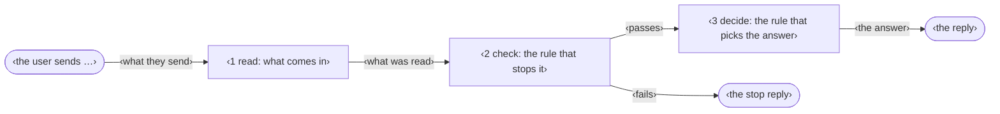

<!-- TEMPLATE for docs/spec.md: the WHOLE discovery in plain English. /discovery writes it first, then plan.md.
WHAT the product must do and why, never HOW: no code, no file names, no function names. Anyone (the client, a new
teammate) can read it top to bottom. Every rule and decision is traced: raw.md:L<n>, data/<file>, or
"decided with user <date>". plan.md (the technical file) cites these ids (B1, D1, S1, G1, E1) and never restates them. -->
# Spec: ‹product name›

## 1. Problem and success (in the client's words)
- **Problem:** ‹what hurts today, who has it› (raw.md:L‹n›)
- **For:** ‹the end user› · **owner:** ‹who runs it day to day and what they check every morning› (raw.md:L‹n›)
- **Success:** "‹their exact words›" (raw.md:L‹n›)
- **What we're building, in one line:** ‹e.g. "a chat on the website that answers 'is my bike ready?' and books a pickup"›

## 2. The demo scenarios (what the client asked to see)
### S1 · ‹happy path›
> ‹the exact conversation / input → output›

Must be true at the end: ‹a positive fact first: something saved, an exact reply in "quotes"› · ‹then what must NOT happen›
### S2 · ‹edge case› …
### S3 · ‹stop / handoff› …
### Bonus · ‹the danger case, if the notes name one› …

## 3. What the app shows
- **Tab 1, ‹the user's door›:** ‹what the user does there›
- **Tab 2, 📊 Owner dashboard:** ‹what the owner sees every day, from the notes›
| Panel | Shows | Works from phase |
|---|---|---|
| ‹KPIs› | ‹…› | ‹2› |
How to check a phase: open the app → look at the Scenario board and the panels → for each Try-it line start fresh, give
the input, compare the reply and the panels.

## 4. The design
How the product works, as logical steps, before any file exists: the thinking the build follows. No file or function
names here (plan.md §3 maps each step to its file).

**Who decides each step**
| Step | Who | Why |
|---|---|---|
| ‹read the messy input› | ‹the AI model / plain code› | ‹it only reads; it never decides› |
| ‹every rule in §5› | plain code | ‹a prompt can be argued with; an `if` can't› |

**Design choices** (what we chose, what we turned down, why)
- ‹Chose X over Y because Z› (B‹n›, D‹n›)

**How we know it works**
‹The checks in plain words: the demo scenarios (§2), the eval cases (§8) and what passing means. For search or
ranking: what each quality number asks, one worked example from the labelled queries, and the target.›

## 5. Business rules
One line each, numbered, plain English, each with its source. The code must follow every one; tests cite them.
- **B1** ‹rule, e.g. "A customer sees a bike's status only after the ticket and last name match the same row."› · raw.md:L‹n›
- **B2** ‹rule› · data/‹file› (‹the fact in the data›)
- **B3** ‹rule› · decided with user ‹date› (see D1)

## 6. Decisions on the ambiguous points
The notes were silent or unclear here, so we asked. Format: the question · the answer · why.
- **D1** ‹question› · ‹answer› · ‹why› · decided with user ‹date›

## 7. Messy data and what we do about it
| # | What's messy | What the product does |
|---|---|---|
| G1 | ‹e.g. the same repair listed twice› | ‹e.g. shows it once› |

## 8. What "good" looks like (the eval cases)
| # | Input | Expected |
|---|---|---|
| E1 | ‹S1 input› | "‹exact reply›" |

## 9. Out of scope (today)
- ‹what we deliberately won't build› · raw.md:L‹n›

## 10. Open questions (ask before the phase that needs them)
- none
