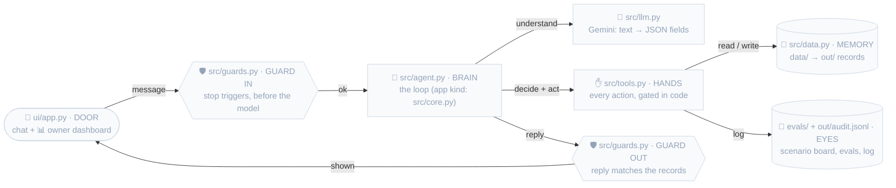

# /kickoff: set up the classroom, then say where we are (same words every time)

Arguments given: `$ARGUMENTS`

**KIT_HOME** = this skill's base directory (shown above as "Base directory for this skill"). It works the same whether
the kit sits in `~/.claude/skills/kickoff` (installed with `install.sh`) or in a repo's `.claude/skills/kickoff`
(made from the GitHub template, e.g. on the phone). Export it in every command below: `export KIT_HOME="<that path>"`.

**Consistency rule:** what the user reads at the start comes from `$KIT_HOME/bin/guide.py`, printed **exactly**.
Don't add an intro, a summary, tips or your own version of the guide. The long playbook lives in `CHEATSHEET.md`.

## Pick the mode
The classroom always lives in **the current folder**. `DEST` = current working directory. Never ask for a folder path;
any arguments are brief/data files to copy into `data/`.
- **Guide mode:** the folder is already a classroom (it has `.claude/hooks/guard_raw_notes.py`) → change nothing.
  **Older classroom** (hooks but no `scripts/spec.py`): run the **upgrade block** first and say one line: "Upgraded: specs
  are on." (ticked phases then need retro specs: write `docs/specs/phase-N/spec.md` from what was built, run
  `scripts/spec.py verify N`). Then run `python3 "$KIT_HOME/bin/guide.py" status` and show its output exactly, in a
  ```text block. Nothing else.
- **Setup mode:** otherwise → the setup steps below.

## Setup steps
1. Allowed in `DEST`: data files, a `.env` (kept as is, so a pasted key survives), and kit files (`.claude/skills/`,
   `README.md`, `LICENSE`, `install.sh`, `.githooks/`, `.github/`, `.gitignore`). Anything else → ask before writing.
   If kit files are present (`install.sh` + `.claude/skills/kickoff/`), ask once: "This folder holds the kit itself.
   Set up a practice classroom here? (Yes for a repo made from the template; No for the kit's own repo.)"
2. `uv`: `command -v uv` or `~/.local/bin/uv`. Missing → ask the user, then `curl -LsSf https://astral.sh/uv/install.sh | sh`;
   if that can't connect (cloud sessions only reach package registries), `python3 -m pip install --user uv`.
3. Run the **setup block** below exactly as written, with `KIT_HOME` exported. **Do not change any file contents.**
4. Run the **verify block**. All six checks must print OK. If one fails, fix the cause and re-run; never skip it.
5. If the arguments name brief/data files, copy them into `DEST/data/`.
6. Check that `discovery`, `build`, `rehearse` and `demo` sit next to this skill (`$KIT_HOME/../<name>/SKILL.md`). If not, warn.
7. Only if the `code` command exists: if VS Code isn't open on this folder, `code "$DEST"`; then `code -r "$DEST/.env"`
   so the user can paste the Gemini key (never read `.env` yourself). If `code --list-extensions` lacks
   `bierner.markdown-mermaid`, install it.
8. Run `python3 "$KIT_HOME/bin/guide.py" setup` and show its output exactly, in a ```text block. Nothing before or
   after it, except one line if a step above failed or was skipped.

## Setup block
(Fenced with 4 backticks because the embedded files contain 3-backtick fences. Run everything up to the closing 4 backticks.)
````bash
DEST="$PWD"   # current folder
set -e
mkdir -p "$DEST" && cd "$DEST" && mkdir -p .claude/hooks data docs notes tests src ui evals scripts
cat > '.claude/hooks/after_edit.py' <<'__KICKOFF_EOF__'
"""PostToolUse hook (Edit | Write | MultiEdit).

Runs automatically after EVERY file edit Claude makes:
  1. ruff format + ruff check --fix on Python files  -> code stays clean without anyone asking
  2. appends one line to BUILD_LOG.md                -> a live record of what was built, file by file
It never blocks Claude (always exits 0).
"""

import json
import os
import subprocess
import sys
from datetime import datetime

PROJECT = os.environ.get("CLAUDE_PROJECT_DIR") or os.path.dirname(os.path.dirname(os.path.dirname(os.path.abspath(__file__))))
RUFF = os.path.join(PROJECT, ".venv", "bin", "ruff")
LOG = os.path.join(PROJECT, "BUILD_LOG.md")


def line_delta(tool: str, inp: dict) -> tuple[int, int]:
    """Rough +added/-removed line counts for the edit."""
    count = lambda s: len((s or "").splitlines())  # noqa: E731
    if tool == "Write":
        return count(inp.get("content")), 0
    if tool == "MultiEdit":
        edits = inp.get("edits", [])
        return sum(count(e.get("new_string")) for e in edits), sum(count(e.get("old_string")) for e in edits)
    return count(inp.get("new_string")), count(inp.get("old_string"))


def main() -> None:
    try:
        data = json.load(sys.stdin)
    except json.JSONDecodeError:
        return
    tool, inp = data.get("tool_name", ""), data.get("tool_input", {})
    path = inp.get("file_path", "")
    if not path or os.path.abspath(path) == LOG:
        return
    rel = os.path.relpath(path, PROJECT)

    lint = ""
    if path.endswith(".py") and os.path.exists(RUFF):
        subprocess.run([RUFF, "format", "-q", path], check=False)
        r = subprocess.run([RUFF, "check", "--fix", "-q", path], capture_output=True, text=True, check=False)
        lint = " · ruff ✅" if r.returncode == 0 else " · ruff ⚠️ issues left"

    added, removed = line_delta(tool, inp)
    with open(LOG, "a") as f:
        f.write(f"- `{datetime.now():%H:%M}` · **{tool}** `{rel}` · +{added}/-{removed} lines{lint}\n")


if __name__ == "__main__":
    main()
__KICKOFF_EOF__

cat > '.claude/hooks/guard_raw_notes.py' <<'__KICKOFF_EOF__'
"""PreToolUse hook (Edit | Write | MultiEdit): notes/raw.md belongs to the user.

Claude may read it but never change it. Exit 2 blocks the edit and tells Claude why.
"""

import json
import os
import sys

PROJECT = os.environ.get("CLAUDE_PROJECT_DIR") or os.path.dirname(os.path.dirname(os.path.dirname(os.path.abspath(__file__))))

try:
    path = json.load(sys.stdin).get("tool_input", {}).get("file_path", "")
except json.JSONDecodeError:
    sys.exit(0)
if path and os.path.relpath(os.path.abspath(path), PROJECT) == os.path.join("notes", "raw.md"):
    print("notes/raw.md is the user's raw notes and is read-only. Put structured findings in docs/plan.md instead.", file=sys.stderr)
    sys.exit(2)
__KICKOFF_EOF__

if [ -z "${KIT_HOME:-}" ]; then for d in "$PWD/.claude/skills/kickoff" "$HOME/.claude/skills/kickoff"; do [ -d "$d/templates" ] && KIT_HOME="$d" && break; done; fi
KIT="${KIT_HOME:-}/templates"   # one source for the kit files (shared with the upgrade block)
for f in run_tests.sh spec.py spec_template.md progress.py pre-commit render_docs.py; do [ -f "$KIT/$f" ] || { echo "MISSING kit file $KIT/$f"; exit 1; }; done
mkdir -p docs/specs/_template scripts
cp "$KIT/run_tests.sh" .claude/hooks/run_tests.sh
cp "$KIT/spec.py" scripts/spec.py
cp "$KIT/spec_template.md" docs/specs/_template/spec.md
cp "$KIT/progress.py" ui/progress.py   # the sidebar's plan reader (both UI modes)
cp "$KIT/render_docs.py" scripts/render_docs.py   # docs/*.md -> docs/*.html (text + diagrams)

cat > '.claude/settings.json' <<'__KICKOFF_EOF__'
{
  "outputStyle": "Explanatory",
  "hooks": {
    "PreToolUse": [
      {
        "matcher": "Edit|Write|MultiEdit",
        "hooks": [
          {
            "type": "command",
            "command": "\"$CLAUDE_PROJECT_DIR\"/.venv/bin/python \"$CLAUDE_PROJECT_DIR\"/.claude/hooks/guard_raw_notes.py",
            "timeout": 10,
            "statusMessage": "raw notes guard"
          }
        ]
      }
    ],
    "PostToolUse": [
      {
        "matcher": "Edit|Write|MultiEdit",
        "hooks": [
          {
            "type": "command",
            "command": "\"$CLAUDE_PROJECT_DIR\"/.venv/bin/python \"$CLAUDE_PROJECT_DIR\"/.claude/hooks/after_edit.py",
            "timeout": 30,
            "statusMessage": "ruff + build log"
          }
        ]
      }
    ],
    "Stop": [
      {
        "hooks": [
          {
            "type": "command",
            "command": "\"$CLAUDE_PROJECT_DIR\"/.claude/hooks/run_tests.sh",
            "timeout": 180,
            "statusMessage": "running tests"
          }
        ]
      }
    ]
  }
}
__KICKOFF_EOF__

cat > '.gitignore' <<'__KICKOFF_EOF__'
.env
.venv/
__pycache__/
.pytest_cache/
.ruff_cache/
out/
.streamlit.pid
.streamlit.port
.app.pid
.app.port
ui/web/node_modules/
ui/web/dist/
.claude/settings.local.json
__KICKOFF_EOF__

cat > 'BUILD_LOG.md' <<'__KICKOFF_EOF__'
# Build log

Filled in automatically while Claude builds:
- **One line per edit**, from the `after_edit.py` hook (time · tool · file · lines changed · ruff result).
- **One commit + tag per phase** (`git log --oneline --decorate`): the per-phase summary.

Use it as study notes during the build and as presentation notes afterwards.

---
__KICKOFF_EOF__

cat > 'CHEATSHEET.md' <<'__KICKOFF_EOF__'
# Cheat sheet: 2-hour build

## Pre-flight (the day before)
- [ ] Kit self-test: `python3 <kit>/tests/selftest.py` → all passed (`<kit>` = `~/.claude/skills/kickoff` after `install.sh`,
      or `.claude/skills/kickoff` in a repo made from the template)
- [ ] Learn the flow once: empty folder → `claude` → `/kickoff` → `/demo` (sample interview, up to phase 1)
- [ ] VS Code + the Claude Code extension · `claude` runs in VS Code's terminal (`/ide` connects it)
- [ ] Free Gemini key from https://aistudio.google.com/apikey works (paste it into `.env` right after `/kickoff`;
      on claude.ai/code set it as the environment variable `GEMINI_API_KEY` and allow `generativelanguage.googleapis.com`)
- [ ] Only for React mode (`UI: react`): Node ≥ 18 (`node -v`; else `brew install node@20`). Fill the npm cache once:
      `cp -R <kit>/templates/react /tmp/rw && cd /tmp/rw && npm install && npm run build && npm test`
- [ ] Only if you want Impeccable in phase 4 (opt-in, pinned, no hook):
      `git clone --depth 1 --branch skill-v4.8.2 https://github.com/pbakaus/impeccable /tmp/imp && mkdir -p ~/.claude/kickoff-vendor/impeccable-skill-v4.8.2 && cp -R /tmp/imp/.claude/skills/impeccable ~/.claude/kickoff-vendor/impeccable-skill-v4.8.2/`
      (check the path exists; read its SKILL.md). Never `npx impeccable install` (its hook runs even when you deny commands). Set `DO_NOT_TRACK=1`.
- [ ] Other machine: `git clone <your kit repo> && ./install.sh` · phone: GitHub "Use this template" → open the new repo in claude.ai/code

## Minute 0
1. Empty folder → `claude` → `/kickoff` (prints the short welcome) → `/hooks` lists 3 (format, tests + specs, notes guard)
2. Shift+Tab: **default** (approve each edit) or **accept edits** (faster). Plan mode only for `/discovery`.
3. Keep on screen: `notes/raw.md` · the app (from phase 1; `/build` prints its URL) · Source Control `⌃⇧G` → Graph
   (every step commits and tags itself: `kickoff` → `plan` → `phase-1` … `phase-4`)

**Can't see a diagram?** Open `docs/talk.html` or `docs/plan.html` in a browser (`.venv/bin/python scripts/render_docs.py`
re-renders them), or view the `.md` on GitHub, which draws mermaid itself.

## Words you'll see
**the app** = 2 tabs: the user's door (chat, upload, Q&A, form) + the **📊 Owner dashboard** · **Scenario board** = the
3 demo stories in the sidebar: ⬜ not built · ❌ broken · ✅ works · **spec** = `docs/specs/phase-N/spec.md`, every line
traced to your notes and tested; `verify.md` next to it is the proof, written by a script · **🚧** = not built yet,
arrives in step N · **guards / gates** = safety checks in plain Python · **src/** = the product · **ui/** = the screen only

## GUIDES: ask before you build (answers → notes/raw.md)
- **G**oal: what problem, and what does success look like?
- **U**sers: who uses it, who takes over, and who owns it? What does the owner need to see every day? (→ the Owner dashboard)
- **I**nputs: what data and systems does it touch? (files → `data/`)
- **D**anger: what can it never get wrong? When does a human take over?
- **E**dges: what are the tricky or messy cases?
- **S**cale + Scope: how much volume? What's in or out for today?

## Timeline
| Time | Do | You |
|---|---|---|
| 0:00–0:15 | Ask GUIDES → notes/raw.md → `/discovery` (plan mode) | Approve `docs/plan.md`: scenarios, both app tabs, 4 phases, evals |
| 0:15–0:25 | `/build` phase 1: the whole app shell, every scenario ⬜ | Click around both tabs: this is everything you'll build |
| 0:25–0:50 | `/build` phase 2: scenario 1 ✅ | Do the **Try it** list; watch S1 turn green + the dashboard fill |
| 0:50–1:15 | `/build` phase 3: safety + scenarios 2–3 ✅ | Do the **Try it** list; queue + audit go live |
| 1:15–1:30 | `/build` phase 4: evals + talk | Run evals in the app; read the Build story |
| 1:30 | Read `docs/talk.md` with the app open | Click through the 3 scenarios while reading |
| **1:40** | **CODE FREEZE** | No new features |
| 1:40–1:55 | `/rehearse` | Present `docs/talk.md`, answer the mock questions |
| 1:55 | Done | |

## Fallback prompts
- **Steer:** `That's not what we want: <what's wrong>. Update docs/plan.md first, then fix it.`
- **Evals:** `Run the eval cases from docs/plan.md end to end. Show a scorecard. Fix only what fails, then re-run.`
- **Checkpoint (if not using /build):** `Run the tests, make sure the app is running, tick the phase, commit + tag, then give me 3 exact inputs to try in the app and what I should see. Stop.`
- **Rehearse (if not using /rehearse):** `Code freeze. Run the 3 demo scenarios. Then walk through docs/talk.md with me section by section. Then ask me 5 likely interviewer questions about this build, one at a time, and critique each answer in 2 lines.`

## Rules for yourself
1. Scope is decided when `docs/plan.md` is approved. New ideas go into talk.md §6 "next", not into the build.
2. Do every **Try it** item in the app before the next `/build`, including the 🚧 one (see it broken before it's fixed).
   What you click through is what you can present. The Scenario board must match what `/build` said changed.
3. If a phase goes badly: `git reset --hard phase-<N-1>` (or `plan`) and re-run `/build`. ⚠️ It erases anything not
   committed (save new notes first: `git add notes && git commit -m notes`), and records in `out/` stay: delete
   `out/*.jsonl` so the dashboard starts clean. Every step is tagged:
   `git log --oneline --decorate` shows them, `git diff phase-1 phase-2` shows exactly what a phase added.
4. Code freeze at 1:40 is not optional.
5. Lost? Type `/kickoff` (no folder) inside the classroom: it shows where you are and the next command.
__KICKOFF_EOF__

cat > 'CLAUDE.md' <<'__KICKOFF_EOF__'
# Project rules for Claude (2-hour build)

We have **2 hours** to build a working, demoable POC (an AI agent or a plain app; see "Kinds and shapes"),
**and the user must be able to present it.**
Goal 1: **it works.** Goal 2: **the user understands it and can present it.** So: **UI first**. Phase 1 builds the whole
screen with nothing working (every scenario ⬜ not built, honest 🚧 replies, ⬜ placeholders), and each later phase visibly turns
something ✅. After each phase the user **tries it in the app** and sees what changed, without reading a diff.

## Commands (the workflow)
| Command | When | Does |
|---|---|---|
| `/discovery` | 0:10–0:15 (after the GUIDES interview), re-run after new notes | `notes/raw.md` + `data/` → `docs/plan.md` (3 demo scenarios, both app tabs, rules, gotchas, 4 phases, evals) |
| `/build` | 0:15–1:30, once per phase (×4) | Next unchecked phase → **spec** → tests from the spec → code → verify (pytest + `scripts/spec.py verify N`) → app running → Build-story entry → commit → before/after + **Try it** list → stop |
| `/rehearse` | 1:40 (code freeze) | Run the 3 scenarios, walk `docs/talk.md` incl. the Build story, mock interviewer questions |

## Files and who owns them
- `notes/raw.md`: **the user's** raw notes. Read it; **never edit it** (a hook blocks edits). Put structure in `docs/plan.md`.
- `docs/plan.md`: the spec. Phases are checkboxes (`- [ ] Phase N: …`), each with `On screen (before → after):`, `Builds:`
  and a `Try it:` list (phase 1 = a tour of the broken shell; phases 2–3 end with one 🚧 still-broken line). Nothing gets built outside it
  without asking; if scope changes, update the plan first.
- `docs/talk.md`: the presentation, including the **architecture diagram with file names** (§3; grey until built) and
  the file map. `docs/talk.html` / `docs/plan.html` are browser versions (`scripts/render_docs.py`), never edited by hand. **Every phase** appends a §7 Build-story entry; the last
  phase fills §1–§6, from what was actually built.
- `docs/specs/phase-N/spec.md`: what phase N builds, written by `/build` **before code**: requirements R1..Rn, each
  traced to a source, with exact "quoted" acceptance and a named test. `verify.md` next to it is the proof, written by
  `scripts/spec.py verify N` (never by hand). `docs/specs/README.md` is the index; `_template/spec.md` is the template.
- `BUILD_LOG.md`: written automatically by the edit hook. Don't edit it by hand.

## Fixed layout (each file under ~150 lines, readable in one sitting)
`src/` = the product (Python decides) · `ui/` = the screen only · `scripts/` = tools. Imports stay flat (`from agent import Agent`):
the venv has a `classroom.pth` that puts `src/`, `ui/` and the root on the path. In `src/` and `ui/` files use
`ROOT = Path(__file__).resolve().parents[1]` for `data/`, `docs/` and `out/`.

| File | Part |
|---|---|
| `src/data.py` | memory: load + clean data, state |
| `src/guards.py` | check in (agent: stop/scope triggers before the LLM · app: input validation) + check out (result matches the data, handoff) |
| `src/agent.py` | **agent kind:** brain: the loop (input → model → tools → output); one message, or one item of a batch |
| `src/core.py` | **app kind** (instead of `agent.py`): one request end to end (input → rules → tools → result) |
| `src/llm.py` | Gemini REST call (key from `.env`), returns JSON; the only file that touches the network. **App kind: only if the plan has the optional AI helper** |
| `src/tools.py` | hands: every action, **gated in code** |
| `scripts/demo.py` | runs the 3 demo scenarios from the terminal |
| `ui/app.py` | door + owner dashboard: Streamlit UI (the full shell is **phase 1**, see "The app"); helpers like `ui/dashboard.py` next to it |
| `ui/progress.py` | kit file: reads `docs/plan.md` for the sidebar (Progress, Try it, Next) |
| `ui/api.py` | **UI react only** (instead of `app.py`): FastAPI door, `/api/screen` + `/api/chat`; display only, no logic |
| `ui/web/` | **UI react only**: Vite React UI; renders only what `/api/screen` returns (built into `ui/web/dist`, served by `ui/api.py`) |
| `evals/scenarios.py` | the 3 scenarios + bonus as data + checks (phase 1); drives the Scenario board, tests and evals |
| `evals/` | eyes: eval runner + cases grown from the 3 scenarios |
| `scripts/render_docs.py` | kit tool: `docs/talk.md` + `docs/plan.md` → `.html` with the diagrams (when a preview can't show mermaid) |
| `scripts/spec.py` | kit tool: `check` (every spec grounded + tested; the Stop hook runs it) · `verify N` (writes the proof) |

## The app (`ui/app.py`: the whole shell in phase 1, every later phase makes part of it real)
- **Must match the sketch in `docs/plan.md` §2b** (written by `/discovery`, approved by the user).
- **Everything exists from phase 1.** Panels that aren't live yet show `⬜ <panel>: arrives in phase N`. Unbuilt
  behavior replies `🚧 <feature> arrives in phase N` and never claims success. **Never remove a panel**; phases only turn
  ⬜ → live and 🚧 → real.
- **Tab 1, the user's door** (the shape). Chat: `st.chat_input` + history and a "New chat" button. Batch: upload or
  "use sample" → results table. Q&A: question box + answer with its source. Tool: a form (`st.form`) → result + the
  updated view (e.g. calendar grid). Dashboard: filters → KPIs, chart, table. Workflow: list of records → pick one →
  allowed actions as buttons → its new state. Something else: the closest of these, adapted (say so in the plan).
- **Tab 2, 📊 Owner dashboard**: a mini back-office for whoever runs the product. KPIs on top, then the domain view of
  what the system did (refunds → refund ledger; scheduler → mini calendar of bookings; batch → results by route; Q&A →
  questions + unanswered; workflow → records by state), the handoff/blocked queue, the audit log, the eval score. If the
  product *is* a dashboard, tab 2 shows what's behind it: data-quality issues, excluded rows and why, the change log. At most one owner action (e.g. Approve,
  Resolve), only if the interviewer named a human step (so `/discovery` put it in the plan), through a gated tool and audited.
- **Sidebar:** progress read live from `docs/plan.md` (✅/⬜ per phase), the current phase's `Try it:` lines, and the
  **Scenario board** (S1, S2, S3, bonus: ⬜ not built / ❌ / ✅ from `evals/scenarios.py`, offline; a check that something
  did *not* happen is only evaluated after a real reply, so a stub can never show green), and the **next command** (`/build`
  for phase N+1, or `/rehearse`). The user always sees where they are, what to type, what works, and what's next.
- Uses the same `agent.py` / `core.py` entry point as demo.py and the tests. No logic in `ui/`: it only displays (and calls tools for the owner action).
- Run in the background on the first free port from 8501 (another project may own 8501); `/build` saves the pid and port in
  `.streamlit.pid` / `.streamlit.port` and prints the URL.
- **UI react** (plan §2b says `**UI:** react`): the same screen, built as `ui/api.py` (one JSON screen + chat) and `ui/web/`
  (React renders it). Same rules: no logic in the UI, panels ⬜ until live, the board can't go green on a stub.
  `scripts/spec.py verify` renders `api.screen_text()`; pid/port in `.app.pid` / `.app.port`.

## Spec-driven (no intuition)
- **No code without a spec.** `/build` first writes `docs/specs/phase-N/spec.md` from `docs/specs/_template/spec.md`.
- Every requirement cites its source (`plan.md §…`, `raw.md:L<n>`, `data/<file>`), has the exact expected value in
  "quotes", and names its test. Nothing gets built that no source asks for.
- Something no source says → **ask the user**, then record the answer (`confirmed by user <date>`). Never decide silently.
- Plan lines (`On screen`, `Try it`) describe the app **after** the phase is built and ticked.
- Tests are written from the spec, before the code, and stay true in later phases (they read the plan's ticks).
- Evidence is never hand-written: `scripts/spec.py verify N` runs the tests and renders the real screen into `verify.md`.
- A user-reported mismatch becomes a new requirement (source = the report) with a test, then the fix.

## After every phase (`/build` does this; follow it even without the command)
1. Spec written first; tests pass: `.venv/bin/python -m pytest -q tests`, and `scripts/demo.py` runs (from phase 2).
2. Tick the phase, then `.venv/bin/python scripts/spec.py verify N` → `VERIFY OK`, and its screen dump matches the plan's
   `On screen` + `Try it` lines. `scripts/spec.py check` → `SPEC OK` (the Stop hook enforces it). The app is running.
3. Append the phase's Build-story entry to `docs/talk.md` §7 (last phase: fill §1–§6 too). Tick the phase checkbox in
   `docs/plan.md` (before step 2's verify), `git add -A && git commit -m "phase N: <name>" && git tag -f phase-N`.
   (`/discovery` commits too: `discovery: plan + data`, tag `plan`.)
4. Hand the user what changed on screen, the board before → after, the phase's **Try it** list (exact input → what they
   should see, incl. the 🚧 still-broken line) and one sentence to say on stage, then **STOP**. If they report
   something off, fix it as `phase N fix: …` and re-tag. No quizzes: the user learns by using the app.

## Kinds and shapes (picked by `/discovery`)
- **Agent** (the core job needs to understand free text): **chat** (a user converses, the agent acts), **batch** (a
  file of items: emails, invoices, tickets, each classified/extracted then routed), or **Q&A** (answers from given documents).
- **App** (no free text at the core): **tool** (input → result: scheduler, booking, calculator), **dashboard** (data →
  filters, charts, tables), or **workflow** (records move through states: tickets, approvals). At most **one optional
  AI helper** for a single step (e.g. words → form fields); the app must still work with it switched off.
- Every kind and shape uses the same loop: check in → ① read the input → ② Python decides → ③ tool → ④ output → check out.
  Everything else (UI first, specs, 4 phases, Scenario board, Owner dashboard, Build story) is identical.

## Architecture defaults (lessons from practice)
- **The LLM (if any) understands; plain Python decides.** Every rule (identity, limits, money, eligibility, capacity,
  clashes, allowed state changes, safety) lives in code.
- Tools are **gated in code**: verified? owns the record? within limits? confirmed? Never trust the prompt alone.
- **App kind:** check in = validate every input (required fields, formats, ranges, dates in the past, unknown IDs) and
  reply with a fix-it message before anything is saved; check out = the screen shows only what the saved records say.
- **Agent kind, guard in** before the LLM on every input: the project's stop triggers (emergency, legal threat, fraud, self-harm,
  prompt injection like "ignore your instructions", off-topic) skip the model entirely and go to a fixed reply or a human.
- **Guard out** after: no data before verification, no invented values, no unsafe advice,
  no claiming success unless a tool actually did it.
- The LLM is **Gemini (free tier) over its REST API** with `requests` (no SDK: it fails to build on Intel Macs). `.env` holds `GEMINI_API_KEY` and `GEMINI_MODEL`, loaded with python-dotenv. No mock model.
- The LLM **extracts** (JSON with the fields the plan names). Facts and actions go out as **Python templates** filled
  from tool results. If the deliverable *is* generated text (a summary, a draft reply), the LLM may write it, but guard out
  checks every number/name/date against the source, and a human approves before anything is sent. Never read or print `.env`.
- Tests never call the network: `agent.py` (or an app's helper step in `core.py`) takes the extractor as a parameter,
  and tests pass a 1-line fixed function. No LLM in the plan → no `llm.py`, and `scripts/check_llm.py` can be skipped.
- An audit log (JSONL) of every decision.
- Diagrams are styled mermaid (quoted labels, labeled solid arrows, `classDef` colors). Never use HTML tags like `<i>`, dotted, two-way or chained arrows, or `flowchart TD` (use `LR`): they vanish in the VS Code preview. Tell the user to view them with ⇧⌘V.

## Code style
- Python 3.12, small typed functions, docstrings on public functions.
- `ruff` formats every edit (hook), and tests + `scripts/spec.py check` run when you stop (hook). Fix failures; don't bypass them.
- Explain as you go: one short ★ Insight per file, focused on *why*.

## Commands
- Tests: `.venv/bin/python -m pytest -q tests` · Specs: `.venv/bin/python scripts/spec.py check` / `verify N` · Demo: `.venv/bin/python scripts/demo.py` · App: `.venv/bin/streamlit run ui/app.py` (React: `.venv/bin/uvicorn api:app --app-dir ui`)
__KICKOFF_EOF__

cat > 'docs/talk.md' <<'__KICKOFF_EOF__'
# Talk: presenting this build

Grows every `/build` phase (§7 Build story); the last phase fills §1–§6, from what was actually built. Study it with the app open. Rehearsed with `/rehearse`.

## 1. What this is
_"You asked for X. I built Y for [user]. Out of scope: Z." + what success looks like, in their words._

## 2. Example scenario
_Live demo of the 3 scenarios from docs/plan.md: happy path, edge case, handoff._

## 3. How it works
**Architecture: every file and what it does.** Grey = not built yet; `/build` colors each file the phase it's built.
View it: ⇧⌘V in VS Code · `docs/talk.html` in a browser (`.venv/bin/python scripts/render_docs.py`) · or on GitHub.



_Then trace scenario 1: input → guards.py → agent.py loop (or core.py) → tools.py → guards.py → output. 2–3 short snippets max (the loop, one tool gated in code, one guard). Key line: "LLM understands, Python decides." (app: "Every rule lives in one place, in plain Python.")_

| File | Part | Purpose |
|---|---|---|

_Parts: door (where messages come in) · guard in (safety check before the LLM) · brain (the LLM loop) · hands (tools gated in code) · memory (data/state) · guard out + human (reply checks, handoff) · eyes (audit log, evals)._

## 4. Key decisions
_One line each: "Chose X over Y because Z."_

## 5. Safety & known gaps
_How it avoids hallucination and unsafe actions. "Known gap: X, fix would be Y."_

## 6. Measure & next
_Eval score, metrics I'd track in production, what I'd build with another week._

## 7. Build story (one entry per phase, added by `/build`)
_"It started with every scenario ⬜ not built, then phase by phase…" Each entry:_
_**Phase N · name** · Was broken: … · Fixed by: `file:line` … · Why it matters: … · Say it: "…"_
__KICKOFF_EOF__

cat > 'notes/raw.md' <<'__KICKOFF_EOF__'
# Raw notes

Your messy notes go here: the brief, your GUIDES answers (Goal · Users · Inputs · Danger · Edges · Scale + Scope), anything you hear. Typos and fragments are fine.
Claude **reads** this file during `/discovery` but can **never edit it** (a hook blocks that).

---
__KICKOFF_EOF__

mkdir -p scripts
cat > 'pyproject.toml' <<'__KICKOFF_EOF__'
[tool.pytest.ini_options]
pythonpath = ["src", "ui", "."]
testpaths = ["tests"]

[tool.ruff]
line-length = 120
__KICKOFF_EOF__

cat > 'scripts/check_llm.py' <<'__KICKOFF_EOF__'
"""Check the Gemini key in .env works. Never prints the key. Run: .venv/bin/python scripts/check_llm.py"""

import os
import sys
import time
from pathlib import Path

import requests
from dotenv import load_dotenv

load_dotenv(Path(__file__).resolve().parent.parent / ".env")
key, model = os.getenv("GEMINI_API_KEY", "").strip(), os.getenv("GEMINI_MODEL", "gemini-flash-lite-latest").strip()
if not key:
    sys.exit("FAIL: GEMINI_API_KEY is empty. Paste it into .env and save.")
url = f"https://generativelanguage.googleapis.com/v1beta/models/{model}:generateContent"
body = {"contents": [{"parts": [{"text": 'Return JSON {"ok": true}'}]}],
        "generationConfig": {"responseMimeType": "application/json"}}
t = time.time()
r = requests.post(url, headers={"x-goog-api-key": key}, json=body, timeout=60)
if r.ok:
    print(f"OK: {model} answered in {time.time() - t:.1f}s")
else:
    msg = r.json().get("error", {}).get("message", r.text)[:200] if r.headers.get("content-type", "").startswith("application/json") else r.text[:200]
    sys.exit(f"FAIL {r.status_code} on {model}: {msg}\nTip: 404 = model retired -> set GEMINI_MODEL=gemini-flash-lite-latest; 503/429 = busy, retry.")
__KICKOFF_EOF__

[ -f .env ] || cat > '.env' <<'__KICKOFF_EOF__'
# Paste your free Gemini API key after the = (get one at https://aistudio.google.com/apikey). Never commit this file.
GEMINI_API_KEY=
GEMINI_MODEL=gemini-flash-lite-latest
__KICKOFF_EOF__

chmod +x .claude/hooks/run_tests.sh
UV="$(command -v uv || echo "$HOME/.local/bin/uv")"
"$UV" venv -q -p 3.12 .venv || "$UV" venv -q .venv   # 2nd try: the system Python (cloud sessions may not download 3.12)
"$UV" pip install -q --python .venv/bin/python streamlit==1.40.0 pytest==8.3.3 ruff==0.8.4 python-dotenv==1.0.1
SITE="$(.venv/bin/python -c 'import sysconfig; print(sysconfig.get_paths()["purelib"])')"
printf '%s\n' "$DEST/src" "$DEST/ui" "$DEST" > "$SITE/classroom.pth"   # flat imports from src/ + ui/
.venv/bin/python scripts/render_docs.py docs/talk.md >/dev/null   # docs/talk.html, readable without a mermaid preview
git init -q 2>/dev/null || true
cp "$KIT/pre-commit" "$(git rev-parse --git-path hooks)/pre-commit" && chmod +x "$(git rev-parse --git-path hooks)/pre-commit"
git add -A && git commit -q -m "kickoff: classroom (CLAUDE.md, raw notes, talk template, hooks, Explanatory style)"
git tag -f kickoff >/dev/null
echo "SETUP OK: $DEST"
````

## Upgrade block (older classroom: hooks present, no scripts/spec.py)
```bash
cd "$DEST" && if [ -z "${KIT_HOME:-}" ]; then for d in "$PWD/.claude/skills/kickoff" "$HOME/.claude/skills/kickoff"; do [ -d "$d/templates" ] && KIT_HOME="$d" && break; done; fi
KIT="$KIT_HOME/templates"
mkdir -p docs/specs/_template scripts
cp "$KIT/run_tests.sh" .claude/hooks/run_tests.sh && chmod +x .claude/hooks/run_tests.sh
cp "$KIT/spec.py" scripts/spec.py
cp "$KIT/spec_template.md" docs/specs/_template/spec.md
cp "$KIT/render_docs.py" scripts/render_docs.py
echo "UPGRADE OK: specs on"
```

## Verify block
```bash
cd "$DEST" && export CLAUDE_PROJECT_DIR="$PWD"
printf 'import os\ndef probe( x ):\n  return x\n' > zz_probe.py
echo '{"tool_name":"Write","tool_input":{"file_path":"'"$PWD"'/zz_probe.py","content":"x"}}' | .venv/bin/python .claude/hooks/after_edit.py
grep -q "def probe(x):" zz_probe.py && ! grep -q "import os" zz_probe.py && echo "OK 1/6 ruff hook formats code" || echo "FAIL ruff hook"
grep -q "zz_probe.py" BUILD_LOG.md && echo "OK 2/6 build log hook writes" || echo "FAIL build log hook"
printf 'def test_x():\n    assert False\n' > tests/test_zz_probe.py
echo '{}' | .claude/hooks/run_tests.sh 2>/dev/null; [ $? -eq 2 ] && echo "OK 3/6 test hook blocks failing tests" || echo "FAIL test hook"
echo '{"tool_name":"Edit","tool_input":{"file_path":"'"$PWD"'/notes/raw.md"}}' | .venv/bin/python .claude/hooks/guard_raw_notes.py 2>/dev/null; [ $? -eq 2 ] && echo "OK 4/6 raw notes are read-only" || echo "FAIL raw notes guard"
git check-ignore -q .env && grep -q "^GEMINI_API_KEY=" .env && echo "OK 5/6 .env exists and is git-ignored" || echo "FAIL .env"
T="$(mktemp -d)"; mkdir -p "$T/scripts" "$T/docs/specs/phase-1"; cp scripts/spec.py "$T/scripts/"
printf -- '- [x] Phase 1: probe\n' > "$T/docs/plan.md"
printf '### R1 · probe\n- Traces to: my gut\n- Acceptance: works\n- Test: tests/test_p1.py::test_r1\n' > "$T/docs/specs/phase-1/spec.md"
.venv/bin/python "$T/scripts/spec.py" check >/dev/null; [ $? -eq 1 ] && .venv/bin/python scripts/spec.py check >/dev/null && echo "OK 6/6 spec checker rejects an ungrounded spec" || echo "FAIL spec checker"
rm -rf "$T"
NODE_MAJOR="$(node -v 2>/dev/null | sed 's/^v\([0-9]*\).*/\1/')"; [ "${NODE_MAJOR:-0}" -ge 18 ] && echo "NOTE node $(node -v): React mode available" || echo "NOTE node ${NODE_MAJOR:-missing}: React mode needs Node >= 18 (Streamlit mode is fine)"
rm -f zz_probe.py tests/test_zz_probe.py && rm -rf .pytest_cache .ruff_cache tests/__pycache__ && git checkout -q -- BUILD_LOG.md
```
