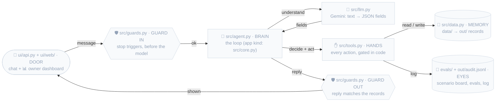

# Talk: <product name>

For the client and anyone watching. Talk it through with the app open. `/build` adds a §7 entry every phase and fills
§1–§6 in phase 4 from what was actually built. Functions are named, never `file:line`; the study file is `docs/plan.md`.

## 1. The problem
_In the client's words: what hurts today, who it's for, and what success looks like (cite requirements.md)._

## 2. What it does: the demo
_The 3 scenarios in demo order, each as "type X → it does Y → the dashboard shows Z". Start a fresh chat between them._

## 3. How it works
**Key line: "The LLM understands, Python decides."** (app kind: "Every rule lives in one place, in plain Python.")
The step-by-step path of scenario 1, with the real object at each step, is plan.md §5e (a test keeps it true).

Grey = not built yet; `/build` colors each file in the phase that builds it. View: ⇧⌘V in VS Code, or `docs/talk.html`.

## 4. Decisions we made together
_3–5 lines, "Chose X over Y because Z", each citing its business rule or decision (requirements.md B<n>)._

## 5. Safety & known limits
_What it never does and what stops it (name the function). "Known limit: X; the fix would be Y."_

## 6. Results & next
_Eval score (live), what we'd measure in production, what another week would add._

## 7. Build story (one entry per phase, added by `/build`)
_"It started with every scenario ⬜, then phase by phase…" Each entry:_
_**Phase N · name** · Was broken: … · Fixed by: `function()` … · Why it matters: … · Say it: "…"_
